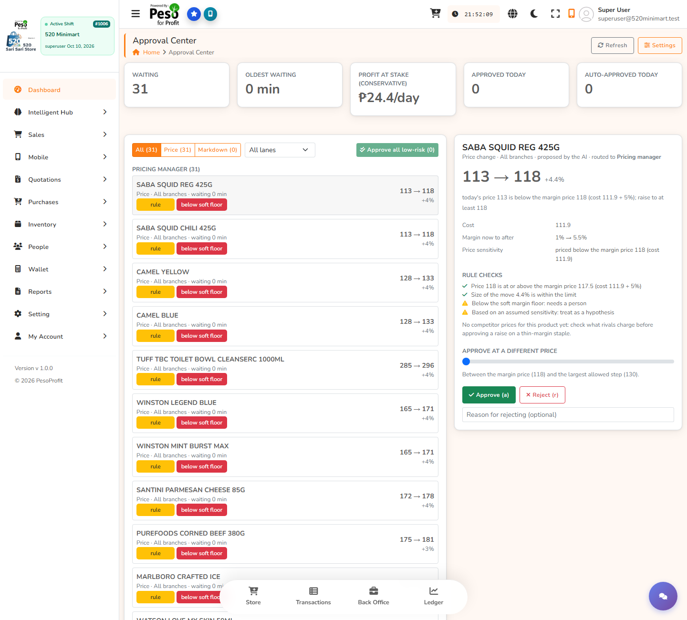
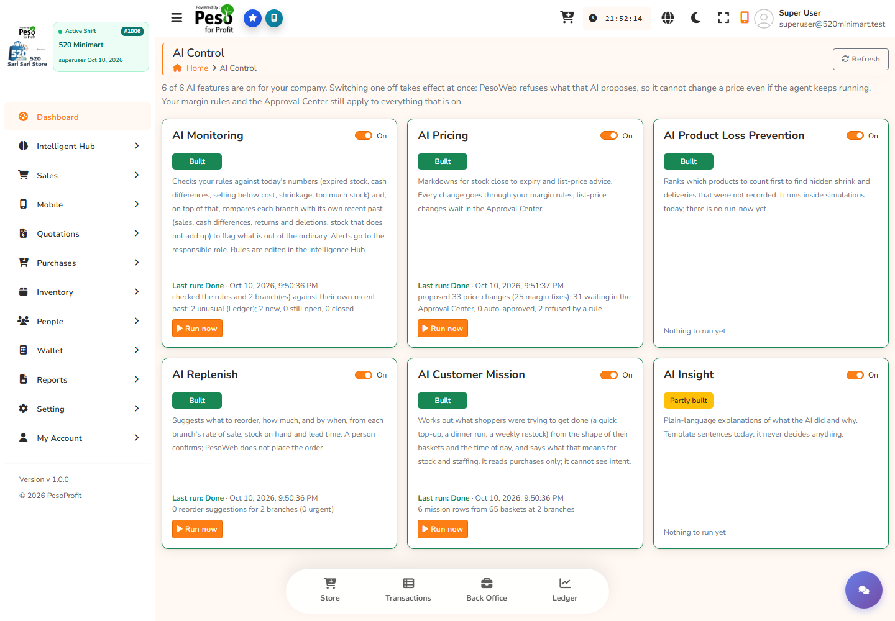
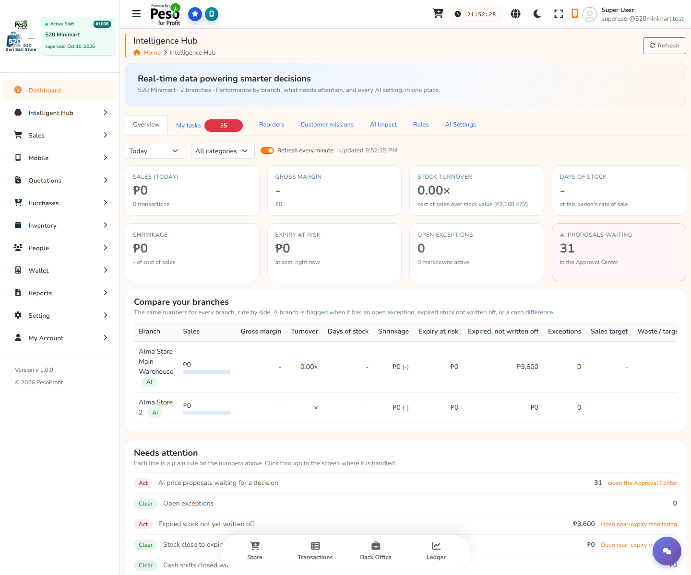
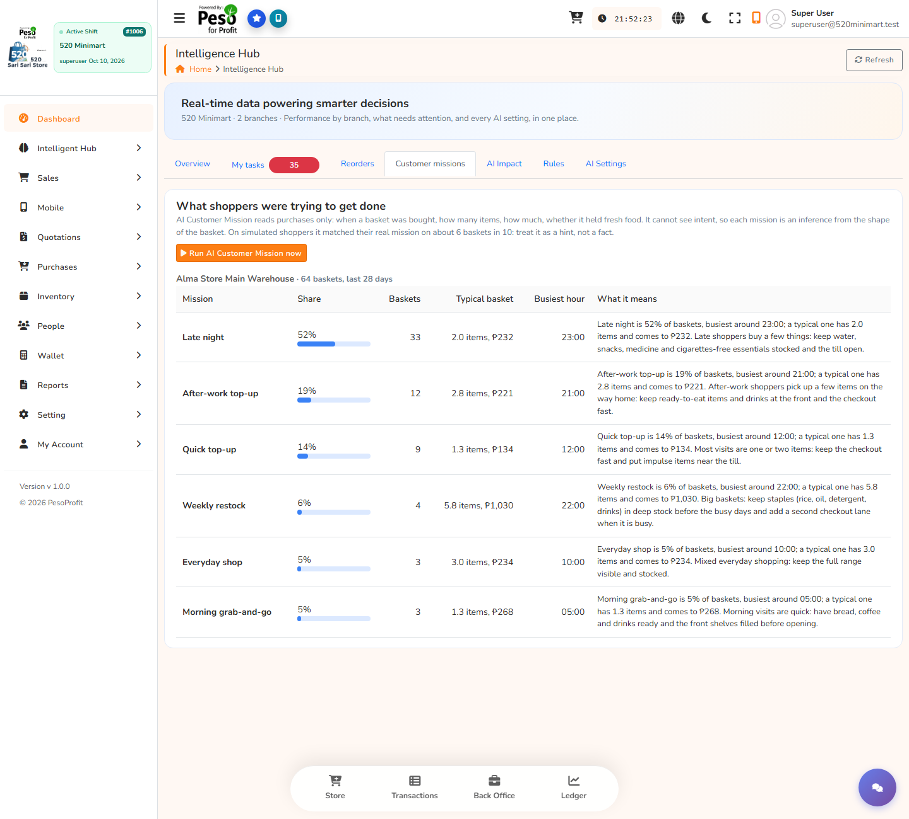

# Using the Intelligent Hub on a real company: complete step-by-step guide

This guide assumes you know nothing about the setup. Follow it in order. Every step says what to click or type, what you should see, and what to do if you don't. It was checked end to end on the real company on 2026-10-10, and the numbers below are what that run showed.

**Time needed:** about 30 minutes the first time.

---

## Part 1. What you are going to do

You will start PesoWeb on your own PC, sign in to the real company **520 Minimart**, switch on a small helper program (the "agent") that lets the AI read that company's real sales, and then press **Run now** on the AI features. The AI then fills the Intelligent Hub with real results: price proposals, mission insight, alerts and reorder suggestions. Nothing here uses the simulator.

Nothing changes a real price or sends an order by itself. Price changes wait in the Approval Center until a person approves them.

---

## Part 2. The facts you need (so you never have to guess)

### The company

| | |
|---|---|
| Company name | **520 Minimart** (it is company number 6 in the database `PesoWeb_MissionDev`) |
| Number of branches | **2** |
| Branch 1 | **Alma Store Main Warehouse** (branch ID 1006) |
| Branch 2 | **Alma Store 2** (branch ID 1013) |
| Products | 489 (488 with a price and cost) |
| Real sales on record | 50 completed receipts over 14 trading days, **April 28 to May 30, 2026**, mostly sold between 10 PM and 1 AM |
| Stock value on the shelf | about ₱2,168,000 at cost |

You do not have to type any ID anywhere. The IDs are only for reference.

### The logins

| Login (email) | What it is | Password | Use it for |
|---|---|---|---|
| **superuser@520minimart.test** (username `superuser`) | The new full-access login for 520 Minimart, on the company's **SuperAdmin** role, both branches | The password you chose when you asked me to create it | **Everything in this guide** |
| `almastoreadmin@gmail.com` | Existing store admin, role "Default User" (no AI permissions) | Yours | Not needed |
| `almaposuser1@gmail.com` | Existing till user, role "Default User" (no AI permissions) | Yours | Not needed (it gets "403" in the AI screens) |
| **superadmin@email.com** | The head (root) login for the whole system | Yours | **Only** to save and restore snapshots (Step 3A) |

If you don't remember the superadmin password, use Step 3B (a command) instead; it needs no login.

### Where things are

| | |
|---|---|
| Project folder | `D:\git\AMD\hackathon_amd_act3\MissionCommerceAI_by_eVo.Ninjas` |
| The AI helper program lives in | `...\MissionCommerceAI_by_eVo.Ninjas\sim` |
| Backups and snapshots (drive D, never C) | `D:\PesoWeb_Backups` and `D:\PesoWeb_Snapshots` |
| The screens (open in Chrome) | `http://127.0.0.1:4200` |

---

## Part 3. Before you start: five quick checks (once)

1. **Open PowerShell:** press the Windows key, type `PowerShell`, press Enter. You will use **two** PowerShell windows. Call them **Window A** and **Window B**.
2. **Free space on D:** you need at least 2 GB free on drive D. Open File Explorer, This PC, and look at drive D.
3. **Python works:** in Window A type `python --version` and press Enter. You should see a version such as `Python 3.13`. If you see an error, tell me.
4. **The database service is running:** in Window A type `sqllocaldb start MSSQLLocalDB` and press Enter. You should see "LocalDB instance ... started" (or "already running").
5. **Go to the project folder:** in Window A type

```powershell
cd D:\git\AMD\hackathon_amd_act3\MissionCommerceAI_by_eVo.Ninjas
```

---

## Part 4. The steps

### Step 1. Start the system (Window A)

Type this and press Enter:

```powershell
powershell -ExecutionPolicy Bypass -File ui\demo\start-demo.ps1
```

Wait. The first start takes **1 to 3 minutes** because the screens compile. When finished you will see:

```
PesoWeb API is up: http://localhost:5071/api/ai/settings
PesoWeb screens is up: http://127.0.0.1:4200/
```

Three small windows may open minimised in the taskbar. Leave them alone; closing them stops the system.

*If it says "did not answer within ... seconds":* wait one more minute and open `http://127.0.0.1:4200` in Chrome. If the page loads, it's fine.

### Step 2. Check you can open the screens

Open Chrome and go to `http://127.0.0.1:4200`. You should see the PesoWeb sign-in page. Don't sign in yet.

### Step 3. Save a safety copy of the database (so you can undo everything)

Do **one** of the two ways. Do this **before** you change anything.

**Way A: from the screen (needs the superadmin password)**
1. At the sign-in page, enter `superadmin@email.com` and your superadmin password. Press Sign in.
2. In the left menu click **Intelligent Hub**, then **Test snapshots** (the last item).
3. Under **Save a snapshot**, in **File name** type `before-real-test` (letters, digits, dashes only).
4. Press **Save snapshot**. It takes a few seconds. You should see "Saved "before-real-test" (205 MB)" in green, and a new row in the table with "Can be restored now: Yes".
5. Sign out (your name at the top right, then Sign out).

**Way B: with a command (no login needed)**
In Window A type (one line):

```powershell
sqlcmd -S "(localdb)\MSSQLLocalDB" -d master -E -b -Q "BACKUP DATABASE [PesoWeb_MissionDev] TO DISK = N'D:\PesoWeb_Backups\before-real-test.bak' WITH COPY_ONLY, INIT, CHECKSUM"
```

You should see "BACKUP DATABASE successfully processed". The file is now in `D:\PesoWeb_Backups`.

### Step 4. Sign in as the 520 Minimart super user

1. Go to `http://127.0.0.1:4200`.
2. Email: `superuser@520minimart.test` (or just `superuser`). Password: the one you chose. Press Sign in.
3. You should see the dashboard, with **520 Minimart** and "Branch ID #1006" at the top left and "Super User" at the top right.

*If sign-in fails:* check the email for typos; the password is case-sensitive.

### Step 5. Set the pricing rules (REQUIRED)

This is the step most people miss. 520 Minimart has **no pricing rules yet**, so PesoWeb refuses every price suggestion from the AI (it logs "No pricing policy is configured"). We tested this: with no rules, all 10 proposals were refused.



1. In the left menu click **Intelligent Hub**, then **Approval Center**.
2. Click the orange **Settings** button at the top right.
3. Fill in exactly these boxes (leave the others as they are):

| Box | Type or choose |
|---|---|
| Pricing autonomy | **Approval** (every change waits for a person) |
| Hard margin floor: never below cost plus (%) | **5** |
| Soft margin floor: below this needs a person (%) | **10** |
| Deepest markdown allowed (%) | **50** |
| Most price changes per product per hour | **6** |

4. Leave "Auto-approve small, learned changes" **switched off**.
5. Click **Save**. A green "Saved" appears.

### Step 6. Start the AI helper (Window B)

The Run now buttons only work while this program is running.

1. Open a **new** PowerShell window (Window B).
2. Type:

```powershell
cd D:\git\AMD\hackathon_amd_act3\MissionCommerceAI_by_eVo.Ninjas\sim
python -m simpeso.agent_service --real --email superuser@520minimart.test --as-of 2026-05-30 --interval 20
```

3. It asks **Password for superuser@520minimart.test:**. Type the super user's password. **Nothing appears while you type; that is normal.** Press Enter.
4. You should see:

```
REAL company superuser@520minimart.test: 2 branch(es), looking at the 28 days to 2026-05-30.
Pricing proposals go to the Approval Center; nothing changes a price or an order without a person or the company's own limits.
polling every 20s for Run now requests; Ctrl+C to stop
```

**Leave Window B open and running** for the rest of the test.

Why `--as-of 2026-05-30`: the real sales are from April and May. This tells the AI to look at the 28 days up to May 30 instead of "the last 28 days", which would be empty.

*If you see "403":* the login is not the super user. *If you see a password or login error:* retry Step 6 and type the password again.

### Step 7. Press "Run now" on the AI features



1. In Chrome, left menu: **Intelligent Hub**, then **AI Control**.
2. You will see six cards. Press the orange **Run now** on each of these four, one after another: **AI Monitoring**, **AI Pricing**, **AI Replenish**, **AI Customer Mission**. (AI Product Loss Prevention and AI Insight have no Run now.)
3. Wait up to 20 seconds (Window B shows a line for each run) and click **Refresh**. Each card shows **Last run: Done** with a sentence.

What the real run showed on 520 Minimart:

| Card | What it said | What it means |
|---|---|---|
| AI Monitoring | "2 unusual (Ledger); 2 new" | At the main branch 488 products, and at branch 2 two products, have a shelf quantity that doesn't match the stock ledger. Most likely the opening stock was entered without ledger entries; a stock count would settle it |
| AI Pricing | "proposed 33 price changes (25 margin fixes): 31 waiting in the Approval Center, 2 refused by a rule" | 25 products are priced less than 5% above their cost |
| AI Replenish | "0 reorder suggestions" | Nothing will run out soon: the shelves hold a lot of stock compared with the sales rate |
| AI Customer Mission | "6 mission rows from 65 baskets at 2 branches" | A picture of why shoppers came |

### Step 8. Look at the results, tab by tab

Left menu: **Intelligent Hub**. Click each item below.

**8.1 Approval Center: the price proposals**
- You should see **31 waiting**. Click any row. The panel on the right shows the reason, the price now and proposed, the cost, the margin before and after, the rule checks, and a slider to approve at a different price. Example from the real run: *SABA SQUID REG 425G: 113 to 118. Cost 111.9, margin 1% to 5.5%, "below the soft floor: needs a person".*
- **Approve changes the real product price.** To practise safely, click **Reject** on a few, or approve one you really want, and then in the same screen use the undo option. If you're unsure, don't approve anything.

**8.2 Overview**



- The tiles under "Today" show ₱0 sales. **That is correct:** the Overview's periods are Today, Yesterday, Last 7 days, Last 30 days and This month, and the real sales are from May. Try "Last 30 days": still ₱0.
- What you do see that is real: stock value ₱2,168,472, **AI proposals waiting 31**, and **Expired stock not yet written off ₱3,600** at the main branch. That ₱3,600 is real expired stock still on the books. The fix is in the Inventory menu (write off the expired items).
- The two branches show a green **AI** chip each (AI markdowns are on).

**8.3 My tasks** (35 items on the real run): the 31 proposals plus 3 alerts (expired stock; the two ledger differences) and anything assigned to you. Each has the button or link that settles it. Click **Got it** on an alert to acknowledge it.

**8.4 Reorders:** empty on this data (see the AI Replenish note above). To see it work you need stock that is running low.

**8.5 Customer missions**



- For the main branch (64 baskets in the 28 days): **Late night 52%**, After-work top-up 19%, Quick top-up 14%, Weekly restock 6%, Everyday shop 5%, Morning grab-and-go 5%. Each row says what it means for stock and staffing. It is an inference from the shape of the baskets, not a fact.

**8.6 Alert rules:** nine rules, each with a limit, a responsible role and a named person. Try changing "Expired stock not written off" to be assigned to yourself and press Save.

**8.7 AI Impact:** says "Too early". That is correct: it needs at least 3 full days after the first AI change that was actually applied. See Step 10.

**8.8 AI Settings:** the six AI features, and a table of the two branches with an **AI markdowns** switch each (see Step 11).

### Step 9. (Optional) Make some real sales today so the Overview comes alive

1. Left menu: **Sales**, then **POS**.
2. Pick a few products, click to add them, choose Cash, and complete the sale. Repeat for 3 to 5 sales.
3. Go back to **Intelligent Hub, Overview**, choose **Today** and click **Refresh**. You should now see sales, margin and stock turnover for today.
4. Back in AI Control press **Run now** on **AI Monitoring** again.

(If PesoWeb asks you to open a cash shift first, follow its prompt and enter an opening amount such as 1000.)

### Step 10. (Optional) Measure the AI against a control branch

1. Approve one price proposal in the Approval Center that you really want.
2. **AI Settings**: switch **AI markdowns** off for **Alma Store 2** and click **Save**. Its chip changes to **Control**.
3. Keep selling normally for **3 or more days**, then open **AI Impact** and click **Compare**. You will see before and after for the whole company, and AI branch against control branch, with the caveats.

### Step 11. Finish and put everything back

When you are done testing:
1. In Window B press **Ctrl+C** to stop the helper.
2. To **undo everything** you did (price rules, proposals, alerts), restore the safety copy:
   - **If you used Way A:** sign in as `superadmin@email.com`, Intelligent Hub, Test snapshots, press **Restore** on `before-real-test`, type `RESTORE`, press **Restore now**.
   - **If you used Way B:** first close the PesoWeb windows (or press Ctrl+C in them), then in Window A:

```powershell
sqlcmd -S "(localdb)\MSSQLLocalDB" -d master -E -b -Q "ALTER DATABASE [PesoWeb_MissionDev] SET SINGLE_USER WITH ROLLBACK IMMEDIATE; RESTORE DATABASE [PesoWeb_MissionDev] FROM DISK = N'D:\PesoWeb_Backups\before-real-test.bak' WITH REPLACE, CHECKSUM, RECOVERY; ALTER DATABASE [PesoWeb_MissionDev] SET MULTI_USER;"
```

   Then start the system again with Step 1.
3. If you don't want to undo, just leave it.

---

## Part 5. If something goes wrong

| What you see | What it means | What to do |
|---|---|---|
| Sign-in page won't load | The system isn't running | Repeat Step 1 and wait 2 minutes |
| "403" in Window B or a blank AI screen | You signed in with a login that has no AI permissions (like `almaposuser1`) | Use `superuser@520minimart.test` |
| A card says **Failed** | The one-line reason is on the card | Tell me the sentence |
| A card stays "Requested" or "Running" | Window B is not running | Do Step 6 again |
| AI Pricing: "10 refused by a rule" and 0 waiting | The pricing rules (Step 5) are missing | Do Step 5, then Run now again |
| Overview shows ₱0 | The company's sales are from May | Normal; do Step 9 |
| "Not enough free space" when saving a snapshot | Drive D is nearly full | Free space on D |
| Port 4200 or 5071 busy | An old copy is still running | Close the minimised PesoWeb windows and repeat Step 1 |

---

## Part 6. What this test shows and doesn't

- **It shows:** the AI reading a real company's own sales, stock and cash; real findings (₱3,600 of expired stock not written off; 25 products priced under 5% above cost; ledger differences; a late-night shopper pattern); price proposals with reasons, behind rules and approval.
- **It doesn't show yet:** that the AI raises profit. That needs real days of sales after real approved changes, with a control branch (Step 10).
- **Thin data:** 14 trading days is enough to see the system work. Treat the price proposals as examples, not as advice, until there is more history. Their price-sensitivity is labelled "assumed".
- **Fixed during this test:** the first real run crashed the pricing feature on a product with no price and no cost ("1PC KN95 MASK"). It now says "set the price first" and carries on. That is a bug only real data could find.
